# Architecture

> **Maintenance contract**: this document describes the system *as built* and must change in the same commit as the code that invalidates it — see `CLAUDE.md` ("`docs/architecture.md` moves with the code"). If a diagram here disagrees with the code, the document is wrong: fix it with the change that made it wrong.

Technical documentation for the system as built. The **domain** lives in [CONTEXT.md](../CONTEXT.md), the **decisions and their rationale** in [docs/adr/](adr/), the **plan** in the [GitHub issues](https://github.com/l1em1on1/social-tennis/issues) (#1 is the spec; the rest are tracer-bullet tickets, grouped by milestone). This file documents the *mechanism*: what runs where, and how the pieces talk.

## System topology

Three services under one Docker Compose project (ADR-0001, ADR-0005). The browser only ever reaches the Next.js BFF; the API has **no published port** and is reachable solely on the compose-internal network. CORS never arises, and auth tokens stay server-side.

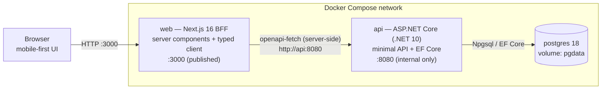

## Request flow

Signed-in pages are **server components** rendered per request (`export const dynamic = "force-dynamic"` on the `(app)` layout — no build-time snapshot). They call the API directly from the server with the generated typed client; no route-handler hop, per Next.js BFF guidance. `getViewer()` (`src/lib/viewer/`) resolves the User once per request (React `cache`), shared by the shell layout and the page.

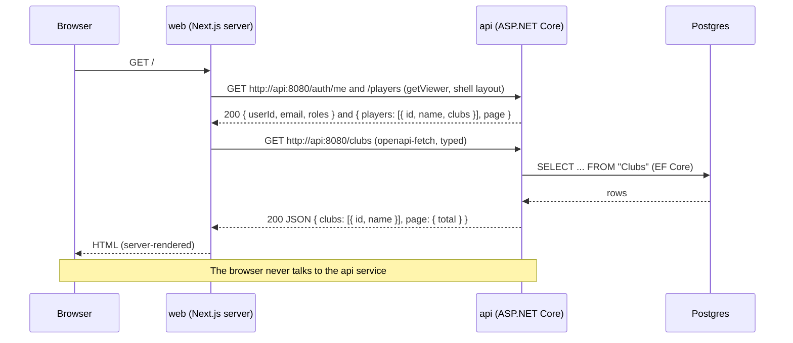

## Authentication

Passwordless magic-link login (ADR-0004), with the session held as an **opaque, revocable API credential** — no JWTs, no key management; logout is a row update and takes effect immediately.

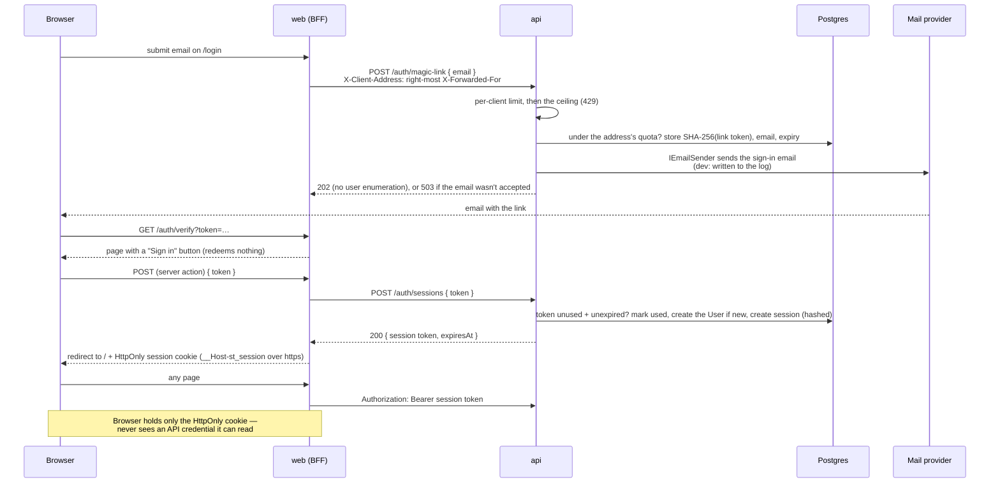

Mechanics worth knowing:

- **Tokens at rest are SHA-256 hashes** (`MagicLinkTokens`, `SessionTokens`); the raw values exist only in the emailed link and the cookie. A database leak leaks nothing redeemable.
- **Magic links are single-use and expiring** (config: `Auth:MagicLinkLifetimeMinutes`, default 15); sessions expire after `Auth:SessionLifetimeDays` (default 30) and die instantly on logout (`RevokedAt`). A link is claimed by one conditional update (`UsedAt IS NULL`), so two redemptions at the same moment make one session, and redeeming one link uses up the address's other unused links (#109). Redemptions for one address run one at a time, under the same per-address advisory lock as requests (`Features/Auth/AddressLock.cs`), so two of its links redeemed at once can't deadlock. A missing or null token is a 401.
- **A User is created when a link is redeemed, not when one is asked for** (#108). A link belongs to an email address (`MagicLinkTokens.Email`, no foreign key), and the first redemption for an address inserts its User (`UserAccounts.EnsureAsync`, which yields to a User a Manager already created by adding a Player for that email). So an address nobody answers for never appears in the Admin's Users list.
- **Two gates on the web side**: `src/proxy.ts` (Next 16's renamed middleware) redirects visitors with no session cookie to `/login` (except the auth pages, `/health` and the privacy notice, `/privacy`) — a presence check only; real validity is enforced per request by the API's `SessionToken` Bearer scheme, and a 401 sends the page back to `/login`.
- **Redirect origins** come from `PUBLIC_BASE_URL` (compose env), because a containerized server's own origin is its bind address — unroutable from a browser.
- **Cookies are `Secure` exactly when `PUBLIC_BASE_URL` is https** (`secureCookies()` in `src/lib/session.ts`), not by `NODE_ENV`. Every image runs as `production`, including over plain http on the compose network, where a browser stores a Secure cookie but never sends it back (only `localhost` is exempt). A TLS deployment must set an https `PUBLIC_BASE_URL` for its redirects anyway, so it gets Secure cookies. Over https the session cookie is named `__Host-st_session` (`sessionCookie()`, #53): the browser accepts it only Secure, on `Path=/` and without a `Domain`, so no other subdomain can plant one. Over http it is `st_session`.
- **Security headers** (#53). `src/proxy.ts` runs on every page request (all paths but `_next/static`, `_next/image` and the icon) and sets:
  - a **Content-Security-Policy** with a fresh nonce per request, as in Next's CSP guide: `default-src 'self'`, `script-src 'self' 'nonce-…' 'strict-dynamic'`, `style-src 'self' 'nonce-…'`, `img-src 'self' blob: data:`, `font-src`/`connect-src 'self'`, `object-src 'none'`, `base-uri 'self'`, `form-action 'self'`, `frame-ancestors 'none'`, plus `upgrade-insecure-requests` over https. The proxy puts the policy on the request too, which is how Next finds the nonce and adds it to its own scripts. That only happens while rendering, so the root layout calls `connection()` and every page renders per request. `next dev` adds `'unsafe-eval'` and inline styles, which React's dev tooling needs.
  - **`Strict-Transport-Security: max-age=31536000`** over https only (no `includeSubDomains`: other names on the domain aren't the app's).

  `next.config.ts` adds the same static headers to every response: `X-Content-Type-Options: nosniff`, `Referrer-Policy: same-origin` (the verify page also sets `no-referrer`, since its address carries the token), `X-Frame-Options: DENY`, `Cross-Origin-Opener-Policy: same-origin`, a `Permissions-Policy` that turns off camera, microphone, location, payment and USB, and no `X-Powered-By`. `e2e/security-headers.spec.ts` asserts the headers on `/login` and on a signed-in page, and that a page runs under the policy with no violations. `e2e/csp-injection.spec.ts` adds a script without the nonce to `/login`'s HTML in flight and checks it is blocked while the page's own scripts run. It turns off Chrome's local-network check for that file only: a page Playwright serves itself counts as public, so Chrome would otherwise refuse its requests to the container's private address (#135). It takes no Chromatic snapshot, because the rewritten page didn't record the same way twice (#155).
- **Ids from forms are checked before they reach an API path**: server actions and pages accept only a UUID (`isId()` in `src/lib/ids.ts`) for any id they put in a path. `/login?sent=` is shown back only if it looks like an email address.
- **OAuth-readiness** (ADR-0004): `ExternalLogins` (provider + subject, unique) hangs off `User`, empty in v1 — adding Google later is additive.
- **Deny by default** (ADR-0017): a fallback authorization policy requires a session on every API endpoint. Only `POST /auth/magic-link`, `POST /auth/sessions`, `/health`, `/health/ready` and the OpenAPI document opt out with `AllowAnonymous()`. `OpenApiContractTests` calls every published operation anonymously and fails if one outside its allow-list answers.
- **Abuse limits on requesting a link** (#108):
  - **Per client, 429.** One client may ask `Auth:MagicLinkRequestsPerClientPerMinute` (default 5) times a minute; then the route answers 429 and the login page says to wait a minute. The client is the browser's address. Every request reaches the API from the BFF, so the BFF reports it: the login action takes the **right-most** `X-Forwarded-For` entry (`src/lib/client-address.ts`), which on Container Apps is the one the ingress appended ("only the rightmost IP is provided by Azure Container Apps"), so a browser that sends its own header still lands in its real bucket. It sends that as `X-Client-Address`, which the API reads (`Authentication/ClientAddress.cs`) and never `X-Forwarded-For`. The API's ingress is internal, so only apps in the environment can set the header. An IPv6 client is keyed by its /64; a request with no usable address shares one `unknown` bucket. Limits are in memory, per replica, which is fine at `max_replicas = 1`.
  - **Across all clients, 429.** `Auth:MagicLinkRequestsPerMinute` (default 60) is a ceiling behind the per-client limit, checked in the handler (`MagicLinkCeiling`), after the middleware, so a client refused by its own limit doesn't use it up.
  - **Per address, 202 and no email.** An address holding `Auth:MaxLiveMagicLinksPerAddressAndClient` (default 5) unused, unexpired links from this client, or `Auth:MaxLiveMagicLinksPerAddress` (default 10) from every client together, gets the usual 202 but no new email. Counting per client means requests from one client can't use up another's links for the same address; the total stops many clients together from mail-bombing it. A link stores a SHA-256 of its client's key (`ClientHash`), not the address. The count and the insert run under a per-address advisory lock (class 1160004), so concurrent requests can't each slip in under the quota. An expired link stops counting the moment it expires.
  - The compose stack raises the per-client limit to 1000, because the E2E suite signs in from one container.
- **Delivery seam**: `RequestMagicLink` knows only `IMagicLinkSender`. Its one implementation writes the sign-in email and hands it to `IEmailSender` (`Email/`), the single seam for all email. The provider behind it is chosen by configuration alone: `Email:Provider` is `Log` by default (the email, link included, is written to the API log, so dev needs no mail account) or `AzureCommunicationServices` (ADR-0020), which also needs `Email:FromAddress` and `Email:AzureCommunicationServices:ConnectionString`. A real provider with settings missing stops the API starting, and so does `Log` outside Development unless `Email:AllowLogProvider` is `true` (#107), which only the compose stack and Terraform's no-email path set. Tests substitute a capturing `IEmailSender` and read the link out of the email.
- **A failed send is a 503, and retryable**: providers throw `EmailDeliveryException` when the mail service refuses the email. The handler then deletes the link it had just stored (it reached nobody, and would otherwise count against the address's quota) and answers 503; the login page says nothing was sent and offers the form again. "Refuses" includes not being reachable: the Azure client is given one retry and a ten-second timeout, so the form isn't left waiting. A send that ends any other way (the caller gone, a bug) removes the link too, and stays a 500, which the login page reports as a fault on our side, never as a bad address. The Azure provider returns once the service has accepted the email, not once it has been delivered, so a bounce is not seen here.
- **Opening the link redeems nothing**: mail scanners and link previewers follow GETs, and would use up a single-use token before its owner clicks. `/auth/verify` is a page with a "Sign in" button; the token is redeemed by that button's POST (a server action), which sets the cookie.

## Errors, health and time

- **Every error has a ProblemDetails body.** `AddProblemDetails` with `UseExceptionHandler` (outside Development, where the developer exception page already answers in the same format) covers unhandled exceptions; `UseStatusCodePages` fills in bodiless 4xx/5xx such as the authorization 401 and the rate limiter's 429.
- **Two health endpoints**, both anonymous. `GET /health` says the process is up and runs no checks, so it never touches the database: it is for a host's liveness probe, because on a scale-to-zero database a probe that queries it every few seconds keeps it awake (ADR-0019). `GET /health/ready` adds "migrated and can reach Postgres" (`AddDbContextCheck`); compose healthchecks and the E2E runner use that one.
- **Logs are JSON outside Development** (#115): one object per line from the built-in JSON console formatter, with scopes, so each line carries its `RequestPath` and `TraceId`. In Azure they land in Log Analytics (`ContainerAppConsoleLogs_CL`, the line in `Log_s`, 30-day retention), where the saved query "API errors" (`azurerm_log_analytics_saved_search.api_errors`) lists errors and crashes from the API and its jobs, with the request path and trace id read from the scopes when there are any. Rows without scopes (startup, jobs) and the runtime's plain-text "Unhandled exception" crash output are kept. `LoggingTests` signs in, uses the session and signs out with every category at Trace, and fails if the link's token or the session token appears in any line. The `Log` email provider writes the link on purpose and is never the production setting (#107).
- **One clock.** `TimeProvider` is registered once and injected into handlers and the session scheme; nothing calls `DateTimeOffset.UtcNow` (ADR-0016). Tests can replace it to stand either side of a deadline.

## Web app shell

The web UI is built on one foundation (ADR-0014), so feature tickets add screens, not plumbing.

- **Design tokens** — `src/app/globals.css`: semantic colours (`bg`, `surface`, `fg`, `fg-muted`, `border`, `accent`, `success`, `warning`, `danger`, `info`, each with a `-muted` background) as `:root` custom properties with a `prefers-color-scheme: dark` override, exposed to Tailwind 4 through `@theme inline`. The default palette is cleared (`--color-*: initial`), so a raw colour utility doesn't exist. Fonts are Geist via `next/font`.
- **Owned primitives** — `src/components/ui/`: Button/ButtonLink, Field + Input, Select (native), Card, Badge, Sheet (native `<dialog>` + `showModal()`), EmptyState, ErrorState, Skeleton/SkeletonGroup. **Every interaction shows it is working:** a form with a server action submits through SubmitButton, which shows a Spinner and is disabled while the action runs (`useFormStatus`), so a second press sends nothing; ButtonLink and the bottom navigation show a Spinner through LinkPending (`useLinkStatus`) from the tap until the next page arrives. A new form or link uses these, not a bare `<button>` or `<Link>`. Domain badge: `src/components/result-status-badge.tsx` (played, retirement, walkover, void, pending). Tap targets are at least 44px (`min-h-11`).
- **Shell** — the `(app)` route group's layout: header with the "Playing as" switcher, page content, bottom navigation (Home, Leagues, Profiles; Manage and Admin by role). `loading.tsx` streams a Skeleton fallback, `error.tsx` an ErrorState whose retry re-fetches the segment; `app/error.tsx` catches what the shell layout itself throws (a failed `/auth/me`), since a segment's boundary sits inside its layout; `app/not-found.tsx` also answers role-refused pages.
- **Acting Player** — the `st_player` HttpOnly cookie, set by the `switchActingPlayer` server action only to an id the User holds; `getViewer()` falls back to the first Player.
- **Players and Clubs** — `getViewer` reads the User's Players from `GET /players` (oldest first; the first is the Acting Player until one is chosen). A User with no Player is asked for their name on Home (`POST /players`); Profiles adds Players and edits their Name, Gender and Level (`PUT /players/{playerId}`, which replaces all three). These routes are scoped to the caller: another User's Player answers 404. Gender and Level are optional, since the first sign-in asks only for a name; Level (1 to 5) is informational and nothing computes from it.
- **Player Rating** (ADR-0007) — every Player starts at 1 and only a Manager may change it (`PUT /players/{playerId}/rating`, 1 to 10000). The web app hides Rating for now (#161): no page shows or edits it, though Manager responses still carry it. The holder's routes carry no Rating and `GET /players` doesn't return it; nothing derives it.
- **Players a Manager adds** — on Manage a Manager adds a Player by name and email (`POST /clubs/{clubId}/players`) for someone who may never have signed in. The Player is a member at once and is held by the User for that email: a User row is made if there is none (`Authentication/UserAccounts.cs`), exactly as asking for a sign-in link makes one, and whoever signs in with that address finds every Player added for it. The Manager's list groups Players by the login holding them and marks logins nobody has signed in with.
- **Joining a Club needs a Manager.** Home's Clubs list lets the Acting Player ask to join (`PUT /clubs/{clubId}/members/{playerId}`, idempotent), which creates a Pending membership. A Manager sees it on Manage (`GET /clubs/{clubId}/members`) and approves (`PUT …/members/{playerId}/approval`) or declines (`DELETE …/members/{playerId}`). Or the Manager invites an email ahead of time (`POST /clubs/{clubId}/invites`). An invite is single-use (#164): it lets in the Players its User already holds, or the first one they add, and is deleted as it does, so it exists only while that User holds no Player. From then on, every Player of that User, added (by them or by a Manager) or asking, is a member of each Club the User is in, i.e. holds an approved member of; a waiting request doesn't count. The app is informal, so this isn't guarded against (owner, 2026-11-19). No email is sent for an invite. A Manager can remove a member and withdraw an unused invite (`DELETE /clubs/{clubId}/invites/{inviteId}`). A Player can leave, or take back a waiting request, from Profiles (`DELETE /players/{playerId}/clubs/{clubId}`); coming back means asking again. The `UseUpJoinedInvites` migration deleted the invites that had already let someone in: those whose User holds a Player in the invite's Club. Whenever a User gets into a Club (an approval, an invite, a Manager adding a Player), their requests still waiting there are approved too (`ClubAdmission.ApproveWaitingAsync`). Every write that decides admission for an email (invite, ask, add a Player, approve, remove) runs in a transaction holding a Postgres advisory lock on that email (`Membership/ClubAdmission.cs`), so concurrent requests can't each miss the other's row. Approving a request and an invite turning waiting requests into memberships are conditional updates, so a request withdrawn at that moment is a 404 or skipped, never a 500. A login can't add a Player itself once it holds 10 (`Player.MaxPerUser`; the `POST /players` is a 409 `player-limit`). Players a Manager added for its email count towards the 10, and a Manager adding a Player is never refused (#109). Names and email addresses refuse control characters (`Validation/TextRules.cs`), and a Gender outside the list is a 400.
- **Leagues** (`Features/Leagues/`, issue #5) — a Manager creates a League for a Club on Manage → New league (`POST /clubs/{clubId}/leagues`): Name, League Type, League Structure, start and end dates (`DateOnly`, a Postgres `date`: calendar dates in the Club's zone, ADR-0016), Stage length (a count of weeks or calendar months), roll mode (Divisional only) and Score format (6 or 9 games a Set, one Set or best of three, and for best of three whether a Match Tiebreak decides). Stage length and Score format are EF Core complex types, columns on the `Leagues` row. The request validator refuses Foursomes + Knockout, a Match Tiebreak on a one-Set Game, and a roll mode missing on Divisional or given on Knockout; the setup form mirrors those rules. A Player's Leagues page (`GET /players/{playerId}/leagues`, the holder's only) lists the Leagues at Clubs they are an active member of: the ones they are in and the ones they could join, with their own Join Request on each. A Player removed from a Club, or who left it, no longer sees its Leagues (#109); withdrawing from a League properly is #21. They ask to join (`POST /leagues/{leagueId}/join-requests`): 404 for a League at a Club they aren't a member of, 409 for a second ask, whatever became of the first. A Manager's League page (`GET /leagues/{leagueId}`) approves or rejects requests (`PUT …/join-requests/{playerId}/approval` or `/rejection`) and adds a Club member straight in (`PUT …/participants/{playerId}`). It also renames the League (`PUT /leagues/{leagueId}`, #153), at any point, with the same name rule as creating (`LeagueNameRules`); nothing else changes. It removes a participant (`DELETE …/participants/{playerId}`, #159), under the same per-League lock. Leagues can't start yet; once they can (#7), removal is refused after the start, because leaving mid-season is a Withdrawal (#21). Removal also deletes the Player's approved Join Request, so they may ask again; a rejected one stays. Every participant has a `JoinedAt`: the request time when approved, the add time when added (or the request time, if they had asked). A rejected request is kept, so the Player sees it. Writes to a League's requests and participants run under a per-League advisory lock (`Features/Leagues/LeagueEntry.cs`). Advisory-lock classes: 1160001 per-email admission, 1160002 per-League entry, 1160003 role changes (`Roles/AdminRoleRules.cs`), 1160004 per-address sign-in links (`Features/Auth/AddressLock.cs`).
- **Roles** (ADR-0022) — `User.Roles` (Manager, Admin) plus `Auth:AdminEmails`, a comma-separated list of addresses that are Admins while listed: that is how the first Admin exists with no database step (in production the `ADMIN_EMAILS` GitHub secret, via Terraform's `admin_emails`). The session scheme turns them into role claims on every request, an Admin carrying Manager too, so a change takes effect at once. Role checks are the named `Manager` and `Admin` policies in each routing table; `GET /auth/me` returns the roles and the web shell reads them from there. Only entries containing `@` count as addresses, so Terraform's placeholder for an empty list (`none`) names no Admin and the last granted Admin stays protected (#109). The role in a role route's path matches in any case.
- **Admin** — the Admin page creates and renames Clubs (`POST /clubs`, `PUT /clubs/{clubId}`) and lists Users with their Players and roles (`GET /users`), granting and removing Manager and Admin (`PUT` and `DELETE /users/{userId}/roles/{role}`). Removing Admin answers 409 for an Admin by configuration and for the last Admin when none is configured (`Roles/AdminRoleRules.cs`); the page disables those controls and says why. The Users list is the first paged list (#134): `GET /users?q=&offset=&limit=` returns 50 by default (100 at most), newest first, with a whole-email match first. `q` matches part of an email or of a Player's name, any case, as text (Npgsql `ILike` with an escape character, so `%` and `_` match themselves). Out-of-range paging or a control character in `q` answers 400. "Last Admin" is still worked out across every User, not just the page. The page's "Find a user" box is a `next/form` GET form, so a search is a URL, and Previous and Next keep it. Every list's `page` block carries `offset` and `limit` (`null` when the list isn't paged; ADR-0012). No Club is seeded: a fresh deployment has none until an Admin creates one.
- **Dev showcase** — `/dev/ui` renders every primitive; it is a 404 in a production build without mocks.

### API mocking (ADR-0009)

All API calls happen server-side in the BFF, so mocking is **MSW in Node mode** only — no browser service worker.

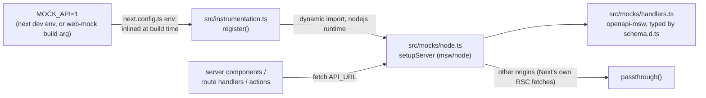

- **Flag at build time.** `next.config.ts` `env` inlines `MOCK_API`; a build without it compiles the `register()` branch to dead code, so no MSW code ships. CI's `build` job asserts that on the production image.
- **Typed handlers.** `createOpenApiHttp<paths>` rejects a path, body, or status the contract doesn't declare. There are no untyped escapes: the 401 the mocks return for a missing session is in the contract.
- **Only the API origin is mocked.** A final catch-all handler calls `passthrough()` for any other origin — its predicate excludes the API origin, because a handler that matches and returns nothing lets the request through instead of failing it — because Next fetches its own origin server-side (a server action's redirect loads the target's RSC payload). Unmatched calls to the API origin fail (`onUnhandledFrame: "error"`): that's a gap in the mocks.
- **Mock auth** accepts any magic-link token and remembers it base64url-encoded in the session token. When the token is an email address, `/auth/me` returns that email, and the mock derives roles from it (`manager`, `admin` in the local part). Against the real API the E2E suite writes the same roles to the database, and its global setup signs in as the compose file's Admin (`admin@example.com`) and creates the suite's Club through the API when the database has none. The mock keeps Players in memory per session, and every sign-in is a new session, so a mocked sign-in starts with no Player just as a first real one does; Club requests and invites are shared across sessions, so one session can approve what another asked for. Leagues are shared the same way, but a Club's League list on Manage shows only the Leagues its own session created, so one test's League never appears in another's snapshot of that page.
- **Privacy notice** (#51, ADR-0024) — `src/app/privacy/page.tsx`, public, linked from the login page, the foot of every app page and the sign-in email (the API builds its address from the sign-in link's origin). The controller and the data-request address come from `PRIVACY_CONTROLLER` (default Hits & Giggles) and `PRIVACY_CONTACT_EMAIL` (`src/lib/privacy.ts`), read per request. Compose sets `privacy@example.com` for the e2e builds; production's comes from the `PRIVACY_CONTACT_EMAIL` repository variable through Terraform (`privacy_contact_email`), which is required: the plan fails without it. Empty (only outside production), the notice says to ask the club's Admin.

## Contract pipeline

The API is the source of truth for the contract. Types flow one way, C# → TypeScript, and the generated client is **committed** so drift is detectable (the CI client-drift job).

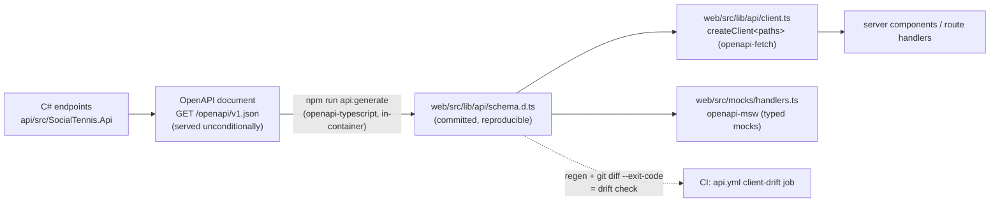

Regenerating with no API change produces no diff — verified property, and the basis of the drift check.

Statuses that come from middleware rather than a handler are put into the document by `OpenApi/UnauthorizedResponseTransformer`: every operation without `AllowAnonymous()` metadata gets a 401 with a ProblemDetails body, read from the same metadata the authorization middleware uses, so the client's types can't disagree with the behaviour.

## Repository layout

```
/
├── CONTEXT.md                  domain glossary (ubiquitous language)
├── docs/
│   ├── adr/                    architecture decision records (0016–0018 proposed)
│   ├── agents/                 agent workflow docs (issue tracker, triage, domain, endpoints)
│   ├── architecture.md         this file
│   ├── phase-1-score-collection.md  non-technical overview of Phase 1: screens, features, user flows
│   └── ui/                     Phase 1 clickable wireframes (one static HTML file, app tokens) — design, not app code; published to GitHub Pages
├── docker-compose.yml          base stack: postgres + api + web (+ api-tests, e2e, storybook profiles)
├── docker-compose.dev.yml      dev overlay: bind mounts, dotnet watch, next dev
├── infra/                      Terraform for the PoC hosting (ADR-0019): toolbox image, root config, modules/
├── scripts/setup-hosting.sh    one-time hosting setup wizard (accounts, state storage, GitHub identity)
├── sandbox.sh                  host entry point for the Docker Sandbox: sbx version, secrets, create, run
├── .sbx/                       Docker Sandbox (sbx) for agents — see .sbx/README.md
│   └── kits/                   v3 mixin kits attached at sandbox creation (<kit>.yaml, + <kit>.dockerfile)
│       ├── toolchain/          .NET 10 SDK + ICU, Node 24, csharp-ls, typescript-language-server; LSP plugins
│       ├── context7/           Context7 MCP egress + proxy-injected API key; Context7 plugin
│       ├── github/             gh + git push over HTTPS, proxy-injected PAT, commit identity
│       ├── nuget/              nuget.org egress for dotnet restore / csharp-ls
│       └── rtk/                the RTK binary, and its Claude Code hook registered at creation
├── .claude/                    Claude Code project config: settings.json (plugins, hooks), skills/
│   └── hooks/                  lsp-restore.sh (SessionStart); worktree-create.sh, worktree-remove.sh (#185)
├── .vscode/extensions.json     extensions VS Code recommends for editing on the host (no C#: no SDK there)
├── api/
│   ├── SocialTennis.slnx       .NET 10 solution (new XML format)
│   ├── Dockerfile              multi-stage: sdk:10.0 build → aspnet:10.0-noble-chiseled-extra runtime (non-root, no shell)
│   ├── dotnet-tools.json       local tool manifest (dotnet-ef)
│   ├── src/SocialTennis.Api/
│   │   ├── Program.cs          minimal API: DI, deny-by-default auth, migrate-on-start, feature registration, OpenAPI, /health
│   │   ├── Domain/             entities (Club, User, ExternalLogin, tokens, ...)
│   │   ├── Data/               TennisDbContext
│   │   ├── Features/           vertical slices: handler per endpoint + routing table (ADR-0010)
│   │   │   ├── Auth/           magic-link request/redeem, per-address lock, current user, logout
│   │   │   │   └── Contracts/  one file per request/response record
│   │   │   ├── Clubs/          Clubs, membership, invites, Players a Manager adds
│   │   │   ├── Players/        the caller's own Players; Rating; leaving a Club
│   │   │   ├── Users/          Users and roles (Admin)
│   │   │   └── Leagues/        League setup, Join Requests, participants, a Player's Leagues
│   │   │       └── Contracts/  one file per request/response record (each feature has one)
│   │   ├── Contracts/          cross-feature contracts — PageInfo (ADR-0012)
│   │   ├── Validation/         FluentValidation filter + ValidatesBody<,>() (ADR-0011)
│   │   ├── Authentication/     session Bearer scheme, magic-link sender, options, token hashing, email rules, User rows, client address, request ceiling
│   │   ├── Membership/         ClubAdmission: who is in a Club without asking, and its per-email lock
│   │   ├── Roles/              AdminRoleRules: when Admin may be removed, and the role-change lock
│   │   ├── Email/              IEmailSender seam, its providers (log, Azure Communication Services), options
│   │   ├── OpenApi/            document transformers (401 on non-anonymous operations)
│   │   └── Migrations/         EF Core migrations
│   └── tests/
│       ├── SocialTennis.Api.IntegrationTests/   HTTP + real Postgres
│       └── SocialTennis.Api.UnitTests/          pure logic only, no DbContext
└── web/
    ├── Dockerfile              multi-stage: node:24-alpine build → standalone runtime as `node`; MOCK_API build arg
    ├── next.config.ts          output: "standalone"; MOCK_API inlined via env; static security headers
    ├── playwright.config.ts    E2E projects: mock (web-mock) and real (web-e2e)
    ├── .storybook/             Storybook (#46): main.ts, preview.tsx (globals.css, Geist), modes.ts (light/dark at 360px)
    ├── e2e/                    Playwright specs; support/ (login, axe, stack readiness)
    └── src/
        ├── proxy.ts            route gate + CSP nonce and HSTS (Next 16 middleware successor)
        ├── instrumentation.ts  starts MSW when MOCK_API=1
        ├── app/
        │   ├── (app)/          signed-in shell: /, /leagues, /profiles, /manage (+ /manage/leagues/new, /manage/leagues/[leagueId]), /admin, /dev/ui
        │   ├── login/          magic-link request
        │   ├── auth/verify/    magic-link landing page; its "Sign in" button redeems the token
        │   └── health/         route handler: 200 when web reaches the API (the deploy check)
        ├── components/
        │   ├── ui/             owned primitives (ADR-0014), each with a *.stories.tsx
        │   ├── shell/          bottom nav and Player switcher, with stories
        │   └── league-setup-form.tsx   the one client-state form: fields that depend on each other
        ├── mocks/              MSW handlers (openapi-msw) + Node server
        └── lib/
            ├── api/            generated schema.d.ts, client.ts, server.ts (session-aware)
            ├── viewer/         getViewer(): User, roles, Players, acting Player (stubbed parts: #4, #18)
            ├── actions.ts      server actions: every form's write, through the API
            ├── league.ts       League wording: Types, Score format and Stage length in words, calendar dates
            ├── mock-mode.ts    MOCK_API / dev-surface flags
            ├── __mocks__/      Storybook's stand-ins: actions.ts replaces actions.ts in stories (#189)
            └── session.ts      cookie names, public-origin + Secure-cookie helpers
```

## Runtime configurations

One compose file is the truth for topology; overlays change *how* services run, never *what* they are (ADR-0005 as amended: nothing on the host but Docker).

| | Base (`docker compose up`) | Dev overlay (`-f docker-compose.dev.yml`) | Docker Sandbox (`./sandbox.sh`) |
|---|---|---|---|
| api | Built image (publish, chiseled `aspnet:10.0`) | `sdk:10.0` + bind mount + `dotnet watch` | Language servers from the sbx `toolchain` kit; stack still via compose, on the sandbox's own Docker daemon |
| web | Built image (standalone `server.js`) | `node:24-alpine` + bind mount + `next dev` | 〃 |
| postgres | `postgres:18-alpine`, `pgdata` volume | same | same |
| Use for | Prod-like verification | Day-to-day development (edit on the host, reload on save) | Agents; deny-by-default egress |

**Mocked API.** With `MOCK_API=1` in the environment, the dev overlay's `web` runs with MSW answering every API call. Start it with `--no-deps` and no `api` or `postgres` is needed. The `e2e` profile's `web-mock` service is the production-build equivalent: the same mocks, baked in with the `MOCK_API` build arg.

**Healthchecks.** `postgres`, `api` and every web service declare one, and each `depends_on` waits for `service_healthy`, so `docker compose up` brings the stack up in order and `docker compose ps` shows what isn't ready. The `api` image is chiseled, with no shell, curl or wget (#25), so its probe is the app itself: `dotnet SocialTennis.Api.dll healthcheck` requests `/health/ready` and exits 0 or 1 without building a host. Under the dev overlay, which runs the SDK image, the probe calls `/health/ready` over bash's `/dev/tcp` instead. The web probe requests `/login` on loopback; the image sets `HOSTNAME=0.0.0.0` so the standalone server listens on all interfaces rather than only the container's own name. `start_period` is 180s to cover the dev overlay's first restore and compile.

Named volumes: `pgdata` (database, survives restarts; `down -v` resets), `nuget` (package cache), `web_node_modules` (keeps `node_modules` off the Windows bind mount), `e2e_node_modules` (the Playwright runner's own install: Ubuntu/glibc, where `web_node_modules` holds Alpine/musl binaries), `storybook_node_modules` and `chromatic_node_modules` (the same, one each, so no service's `npm ci` replaces another's install mid-run).

### Docker Sandbox

Where agents run: Claude Code inside a [Docker Sandbox](https://docs.docker.com/ai/sandboxes/) (`sbx`). It meets ADR-0005's rule (nothing on the host but Docker and `sbx`). Network egress is **deny-by-default**, and **credentials never enter the container**. The workspace is bind-mounted, so the sandbox edits the real repo. [`.sbx/README.md`](../.sbx/README.md) is the canonical reference for commands and setup. This section covers the mechanism.

`sandbox.sh` (run on the host; `--help` lists its options) is idempotent. Each step runs only when its output is missing:

0. **sbx version**: the kits are v3, which needs sbx 0.51 or later. An older sbx stops the script; a version it can't read only warns.

1. **Secrets**: prompts with hidden input for any of `github` and `context7` that is missing from sbx's global secret store, and pipes each value in on stdin. `--set-secret <service>` replaces one secret.
2. **Sandbox**: `sbx create ... claude .` with all five kits, if no sandbox named `social-tennis` (or `--name`) exists. sbx builds the local kits' images itself, with the host's Buildx, so there is no template step. That needs a builder that exports OCI images, which the default `docker` driver can't with Docker's classic image store, so the script first creates a `docker-container` builder (`sbx-kit-builder`, once) and selects it with `BUILDX_BUILDER`, unless `BUILDX_BUILDER` or `SBX_KIT_BUILDER` is already set. Kits attach only at creation, so changing one needs `sbx rm` followed by a re-run; `--name` creates a second sandbox beside a working one.
3. **Remote Control setting**: `sbx settings set claude.remoteControl true` if it is not already on. This is a host-wide sbx setting, not a kit: sbx keeps Remote Control's credentials on the host, and its proxy supplies them to sandboxes only while the setting is on. A failure only warns. `--no-remote-control` skips this step, the server and the flag in step 5.
4. **Detached, with a Remote Control server** (#179): `sbx run -d` starts the sandbox detached, so it keeps running with no session open (closing the terminal or logging out doesn't stop it). `claude update` runs in it (a failure only warns). Unless one is running, `sbx exec` starts `claude remote-control`, Claude Code's server mode, in a tmux session, `remote-control`. claude.ai/code and the app start sessions in the repo through it on demand. Started through `exec`, the server and its sessions have the sandbox's whole environment (the commit identity, the sentinels), which a kit startup hook wouldn't: hooks see only the variables they list. A loop restarts it every 30 s, for instance until `/login`. The server's first start in a new sandbox asks "Enable Remote Control? (y/n)", and it is not listed until that is answered. So for the first 2 minutes of each start, a watcher in the loop types `y` and then Enter when the pane's last line is exactly that question. Claude Code keeps the answer in the sandbox's `~/.claude.json`, so it is asked again only after `sbx rm`. After a sandbox stop, the next run of the script starts it again. `--install-service` (#180, Linux with systemd) does that at boot. It writes a systemd user unit, `sbx-<name>.service`, which is a oneshot running the script with `--no-attach`, plus `--no-remote-control` and `--debug` when given. With `RemainAfterExit=yes`, the sbx daemon it starts stays in the unit's cgroup. That daemon runs every sandbox on the host, so the unit sets `KillMode=process`: a stop runs `ExecStop` (`sbx stop <name>`) and kills at most the script, if it is still running. Under the default, `control-group`, it would kill the daemon and every other sandbox. A `systemd-run --scope` wrapper was rejected: at shutdown its scope can stop before `ExecStop` runs. It also turns on lingering, so the unit runs with no login.
5. **Attach** (unless `--no-attach`): `exec sbx run -- --remote-control`, so the session is reachable from claude.ai/code and the Claude mobile app as soon as it starts. It needs a claude.ai `/login` inside the sandbox, and no egress beyond `api.anthropic.com`.

The sandbox is sbx's built-in **`claude` agent**, a published v3 kit (`docker.io/sbx/claude`: Debian 13, Claude Code, git, gh, Docker), plus five **v3 mixin kits** (#175). sbx 0.51 made the built-in agent v3, and a sandbox can't mix v3 kits with v1 or v2 ones, which ended the earlier custom template and v2 kits. Each kit is a descriptor (`<kit>.yaml`, Docker's [sandbox kit spec](https://github.com/docker/sandbox-kit-spec)) of capabilities: `network-policy@1` for egress, `credential@1` for a proxy-held secret, `lifecycle@1` for install hooks, `agent-context@1`/`@2` for instructions. Two kits also have image content (`<kit>.dockerfile`, multi-stage, ending `FROM scratch`), which sbx builds and layers over the agent's image. The wiring lives in the repo, and the only per-machine step is storing the secret values. sbx writes the kits' instructions into a section it manages in the sandbox's `~/.claude/CLAUDE.md`, outside the workspace, so the tracked `CLAUDE.md` is never modified. `docker buildx build -f .sbx/kits/<kit>/<kit>.yaml .sbx/kits/<kit>` checks a descriptor strictly with only Docker.

- **`toolchain` kit** carries what the claude kit lacks: the .NET 10 SDK copied from the same `dotnet/sdk` image and digest as `api/Dockerfile` (ICU from that image too, since the claude kit has none), Node 24 and `typescript-language-server` with TypeScript pinned to 5.x (the 7.x native port ships no `lib/tsserver.js`, which the language server loads), and `csharp-ls`, each linked into `/usr/local/bin`. Nothing relies on an `ENV` in the kit's image, which Docker's docs don't say reaches the sandbox: `/usr/local/bin` is on the claude kit's `PATH`, which the LSP plugins inherit from Claude Code, and .NET tools find the runtime through `/etc/dotnet/install_location`. An install hook adds the `csharp-lsp` and `typescript-lsp` plugins, with `github.com` allowed while hooks run (the marketplace is a git repository).
- **Hook order.** The claude kit's own install hook writes `~/.claude/settings.json` from scratch, and install hooks run a provider's before its requirers'. So every kit whose hook changes Claude Code's configuration (`toolchain`, `context7`, `rtk`) declares `requires: [claude]`.

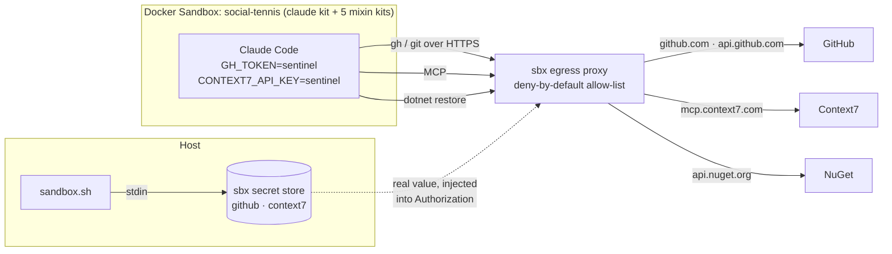

- **`github` kit** declares sbx's built-in `github` service as a `credential@1`, with a PAT of `l1em1on1-claude`, a dedicated account with write access to this repo only. The proxy sets `Authorization: Bearer <token>` on `github.com` and `api.github.com` (Docker's docs say sbx ignores the spec's Basic `scheme` in v3). The credential names `GH_TOKEN`, so it holds a sentinel, because `gh` refuses to run without a token in its environment. Four args with `env:` set `GIT_AUTHOR_*`/`GIT_COMMITTER_*` so sandbox commits are that account's. These are environment variables because the bind-mounted `.git/config` holds the host's identity and repo config beats `--global`. SSH (`github.com:22`) is blocked, so the kit adds a global `url.https://github.com/.insteadOf git@github.com:` rewrite to the agent's own git config. The bind-mounted `.git/config` stays on SSH for the host.
- **`nuget` kit** only allows egress to `api.nuget.org`; it has no credential. `csharp-ls` needs a restore done *in the sandbox*, because `obj/project.assets.json` records absolute package and project paths.
- **Language-server restores** (#121). A `SessionStart` hook (`.claude/hooks/lsp-restore.sh`) restores what the language servers read when it is missing or stale: `dotnet restore` synchronously (seconds; Claude's first reply waits for it), `npm ci --ignore-scripts --no-bin-links` in `web/` asynchronously (minutes on the bind mount, which refuses symlinks). Compose's .NET services set `SOCIAL_TENNIS_CONTAINER_BUILD=true`, which `api/Directory.Build.props` maps to `obj/container/` and `bin/container/`, so Docker builds and tests never overwrite the language server's `obj/`. These restores feed the language servers only; builds and tests stay in compose. Worktrees (#185) go in `.claude/worktrees/` (gitignored): a `WorktreeCreate` hook (`worktree-create.sh`) replaces Claude Code's own creation with the same thing (a branch from `origin/main`, or the `worktree-<name>` branch an earlier one left), writes a unique `COMPOSE_PROJECT_NAME` (`social-tennis-wt-<name>-<checksum of the name>`) to the worktree's `.env` so its containers and volumes are its own, and starts both restores for the new checkout in the background, so LSP works there; `lsp-restore.sh` takes the checkout as an optional second argument, resolved to an absolute path, and locks per checkout. `worktree-remove.sh` stops that compose project with the dev overlay too (`down -v`, only when the `.env` names it) and removes the worktree, keeping the branch.
- **`context7` kit** declares a custom `context7` service. The proxy rewrites the plugin's `Authorization` header to `Bearer <key>` for `mcp.context7.com`. The Docker MCP Toolkit's stored copy of the key can't be read back, so sbx keeps its own. Its install hook adds the Context7 plugin.
- **`rtk` kit** has no egress or credential. Its image content is the RTK binary in `/usr/local/bin`, and its install hook runs `rtk init -g --auto-patch` as the agent, registering RTK's PreToolUse hook in `~/.claude/settings.json` after the claude kit has written that file.

## Deployment (PoC)

The PoC is hosted on Azure Container Apps with Neon for Postgres, both scaled to zero when idle (ADR-0019). The topology is the compose one with the database moved out: `web` is public, `api` has internal ingress only, and nothing else is exposed.

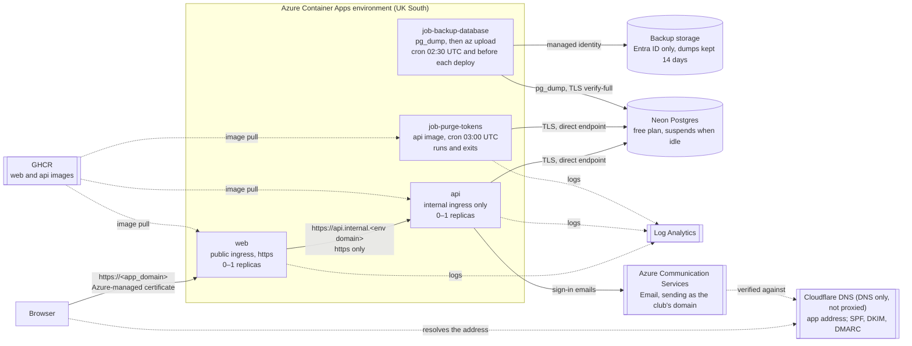

- **Scale to zero.** After about five idle minutes both apps stop and Neon suspends its compute. The next request starts `web`, then `api` (which checks migrations), then the database. The first page load after idle has not been measured yet; it is recorded here once the environment exists.
- **web to api over https** (#111). `API_URL` is the api app's internal address (`ingress[0].fqdn`, `api.internal.<environment domain>`) with `https://`, and the api ingress sets `allow_insecure_connections = false`, so a plain-http request is redirected rather than served. The short name `http://api` that Container Apps also resolves is plain http, so web doesn't use it. Traffic never leaves the environment either way; https keeps session tokens off the wire in clear inside it too.
- **Probes.** Azure probes the API on `/health`, which runs no checks, so probing never wakes the database. The startup probe allows two minutes for a cold start. `web` is probed on `/login`, which calls nothing. Web's own `/health` (`src/app/health/route.ts`) asks the API's `/health` and answers 200 or 503; anonymous visitors may open it. The deploy check uses it, not the probe, since it wakes the API.
- **Single replica.** Each app runs at most one replica, because the API migrates on startup. `always_on = true` raises the minimum from 0 to 1. `long_cooldown = true` keeps an idle app for 30 minutes before it scales to zero, not Azure's default 5. Both are inputs of the deploy workflow, off by default, and hold only until the next deploy.
- **Database connection.** The API uses Neon's direct endpoint, not its pooler: startup migration holds a session advisory lock, which a pooled connection would break. The lock is taken on the app's own database (`Database__MigrationLockDatabase`), since a Neon role may not be allowed into `postgres`.
- **Addresses** (ADR-0021). The app is served at `https://<app_domain>`: a custom domain on `web` with an Azure-managed certificate, reached through a DNS-only A record (to the environment's static address) and an `asuid` ownership TXT record in Cloudflare. `PUBLIC_BASE_URL` and `Auth__VerifyUrlBase` are derived in Terraform: from `app_domain` once `app_domain_ready` is true, and from the environment's own domain before that or when `app_domain` is empty. Either way the address is https, so session cookies are `Secure`. The address Azure assigns keeps answering (Terraform output `default_url`). Getting there takes the same two deploys as email, with `scripts/setup-domain.sh` binding the certificate in between: the provider can't bind a managed certificate, and its custom domain resource ignores the binding so later applies leave it alone.
- **Email** (ADR-0020). Sign-in emails go out through Azure Communication Services from `DoNotReply@<email_domain>`. The domain's DNS is in Cloudflare, where Terraform creates the ownership, SPF, DKIM and DMARC records. It takes two deploys, because Azure checks the records in between and Terraform has no resource for that step: the first (with `email_domain` set) creates the mail resources and DNS records; `scripts/setup-domain.sh` then has Azure verify them and sets `email_domain_verified`; the second links the domain and gives the API its `Email__*` settings, the connection string as a Container Apps secret. Until that second deploy, and whenever `email_domain` is empty, the API logs sign-in links instead (README, "Hosting").
- **Scheduled jobs** (#112). Nothing runs all the time, so work on a timer is a Container Apps Job per job (`azurerm_container_app_job.scheduled` in `modules/compute`, cron in UTC). It starts the API image with `job <name>` (`dotnet SocialTennis.Api.dll job <name>`), which builds the API's services, runs that one job (`api/src/SocialTennis.Api/Jobs/`), and exits: 0 when it finished, 1 when it threw, 2 for an unknown name. It neither serves requests nor applies migrations, so a job that runs before the first start of a new API version can fail, and is retried once, then runs again the next day. Jobs are idempotent and read time from the injected clock (ADR-0016). Today there is one: `purge-tokens`, daily at 03:00 UTC, deletes used or expired sign-in links and expired or revoked sessions. Retention (#117) and auto-roll (#10) will be more. Locally: `docker compose run --rm api job purge-tokens`.
- **Backups** (#137, `modules/backup`). Neon's free plan keeps 6 hours of point-in-time history. A second copy, kept longer and outside Neon:
  - **The job.** `job-backup-database` runs at 02:30 UTC, before the token purge. An init container (`postgres:18-alpine`) runs `pg_dump --format=custom --no-owner --no-privileges` into an EmptyDir volume, over the direct endpoint with `sslmode=verify-full` against the image's CA bundle (`modules/database` output `libpq_uri`). Then the Azure CLI image signs in as the job's user-assigned identity and uploads the file to `backups/dumps/<UTC time>.dump`. No image is built for it: both are public and pinned by digest.
  - **The storage.** Its own account: Entra ID only (no shared key, no SAS, nothing public), TLS 1.2, infrastructure encryption. A lifecycle rule deletes dumps after 14 days, and blob soft delete keeps a deleted one for 7 more. Terraform manages the account through Azure Resource Manager only (`features.storage.data_plane_available = false` in `versions.tf`), so the Contributor deploy identity needs no data-plane role.
  - **The one owner step.** The deploy identity can't grant roles, so the owner gives the job's identity Storage Blob Data Contributor on the container, once, after the deploy that creates it (README, "Backups").
  - **Before each deploy.** The apply job signs in with `azure/login` and starts the job through Azure Resource Manager (`az rest`), waiting up to 15 minutes. A failed backup stops the deploy. `skip_backup` skips it, and on the first deploy, before the job exists, the step says so and goes on.
  - **Restoring:** `docs/runbooks/restore-database.md`, which #52's drill follows.
- **Cost guard.** A budget on the resource group emails when actual or forecast spend reaches the configured amount.

### Terraform (`infra/`)

| Piece | Where | Note |
|---|---|---|
| Toolbox image | `infra/Dockerfile`, `infra/compose.yml` | Terraform + Azure CLI in one image, so neither is installed on the host (ADR-0005) |
| Root | `infra/*.tf` | Resource group, the four modules, the budget |
| `modules/database` | Neon project, database, role | Its contract is three outputs (Npgsql connection string, the same as a libpq URI for `pg_dump`, database name), so the community-maintained Neon provider can be swapped for a hand-made project |
| `modules/compute` | Log Analytics (with the saved "API errors" query), environment, `web`, `api`, scheduled jobs | One Container Apps Job per entry in `local.jobs` |
| `modules/domain` | Cloudflare A and `asuid` TXT records, custom domain on `web`, managed certificate | Only created when `app_domain` is set. Waits 60 seconds after creating the TXT record, since Azure checks it at once. Binding the certificate is the wizard's step |
| `modules/backup` | Storage account and container for dumps, lifecycle rule, the job's identity, `job-backup-database` | The job's role on the container is granted by the owner, once (README, "Backups") |
| `modules/email` | Communication Services, Email service and domain, Cloudflare DNS records | Only created when `email_domain` is set. The domain is linked, and sending switched on, only once `email_domain_verified` is true |
| State | Azure Storage, `azurerm` backend | Account name passed by `infra/init.sh`; access by Azure AD role, no account key |
| Providers | `infra/.terraform.lock.hcl` | Versions and checksums for `linux_amd64` and `linux_arm64`. Every `terraform init` (CI, deploy, `init.sh`) runs with `-lockfile=readonly`, so a provider that doesn't match its checksum stops the run |
| Setup | `scripts/setup-hosting.sh` | The steps that need a person. Written without access to an Azure or Neon account, so untested end to end |

`infra.yml` checks formatting and validates the configuration on every PR, with no cloud credentials. Planning and applying against the real environment belong to the deploy workflow below, which runs on `main` only, so a pull request never holds a credential that can change infrastructure.

### Release flow (`deploy.yml`)

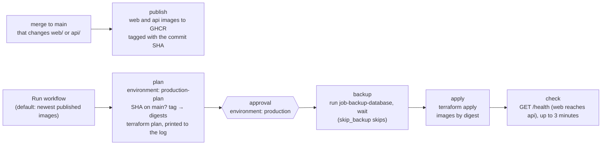

- **Publishing and deploying are separate.** A merge to `main` that changes `web/` or `api/` publishes images; other merges build nothing. Nothing is deployed until someone runs the workflow and approves it.
- **Which images.** With no SHA given, the workflow walks back from the commit it runs on to the first one that has images. Commits in between changed neither app, so those images hold the same code.
- **Only `main`, and only what was planned.** The plan job refuses a SHA that is not a commit on `main` (GitHub's compare API), then resolves the two images' tags to digests. Terraform gets `image@sha256:…`, and the apply job is handed the same digests, so it runs exactly the images that were planned even if a tag is pushed again in between. A plan run by hand with only `-var image_tag=SHA` still works, by tag.
- **One mechanism.** A release is `terraform apply` with different images, so infrastructure changes and releases take the same path. **Rollback** is the same run with an earlier SHA.
- **Credentials.** Azure trusts a short-lived OIDC token, and only for the `production-plan` and `production` GitHub environments; both deploy from `main` only, and `production` needs a reviewer. No cloud key is stored in GitHub. The Neon API key, the Cloudflare API token (DNS edit on the one zone), the alert email and the Admin addresses are secrets of the `production-plan` and `production` environments, never repository secrets (#104, #113): only the deploy jobs, running from `main`, can read them. The setup wizards set them there and never write the two API credentials to `infra/.env`; a local plan or apply takes them from the shell (`infra/compose.yml`). The email domain, the app's domain, and whether each is ready are repository variables. The Terraform state account allows only Entra ID access (no shared keys), with blob versioning and 30-day soft delete.
- **Back up, then apply.** After approval, the database is dumped first (see "Backups" above), and a failed backup means nothing is deployed.
- **The plan is never uploaded.** A saved plan file contains the database password, and a public repo's artifacts can be downloaded, so `apply` plans again.
- **Migrations** still run when the API starts.
- **The check** requests web's `/health`, which answers 200 only when web reaches the API over the address production uses (#111). It allows three minutes because the first request after a deploy is a cold start of web and then the API. The database isn't touched.

### Updating Terraform providers

Because `init` is read-only, changing a provider version is a deliberate step. Edit the constraint in `infra/versions.tf`, then update the lock file and commit it with the change:

```bash
docker compose -f infra/compose.yml run --rm infra sh -c \
  "terraform init -backend=false -upgrade && terraform providers lock -platform=linux_amd64 -platform=linux_arm64"
```

This needs the Terraform registry, which the Docker Sandbox can't reach. The lock file was first generated on a GitHub runner.

## Database and migrations

EF Core migrations live in the API project; **the API applies them on startup** (`MigrateAsync` behind an `EF.IsDesignTime` guard), so `docker compose up` needs no separate migration step. The step is serialized by an advisory lock taken on the `postgres` maintenance database; `Database:MigrationLockDatabase` changes which database holds the lock, for a hosted Postgres where the app's role can't open `postgres`. Per EF Core guidance this pattern fits dev/test and single-instance deployments — which v1 is; the exit is scripted migrations (`dotnet ef migrations script`) before scaling past one API instance.

New migrations are generated in-container — see the [README](../README.md) for the exact commands (README is the canonical command reference; this file doesn't duplicate it).

## Testing seam

The default seam, per the spec's Testing Decisions (issue #1): integration tests drive the API **over its HTTP boundary against a real Postgres** — no mocked repositories, no in-memory provider. Anything touching the database is tested this way.

ADR-0010 adds one narrow exception rather than a second general seam. Because endpoint handlers and request validators are directly callable, pure logic **with no `DbContext`** may be unit-tested in `SocialTennis.Api.UnitTests`. That project references no test host, so the boundary is structural: if a test needs the database, it cannot live there. For validators the boundary is stronger still — ADR-0011's `new()` constraint means a validator cannot take a `DbContext` even in principle.

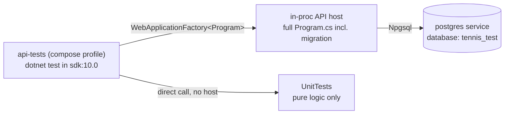

### Frontend: Playwright E2E (ADR-0014)

The frontend seam is end to end: server components and server actions do most of the work, and only a real browser against a real server exercises them honestly. Domain rules stay tested at the API seam above; each feature ticket adds its screen's happy path here.

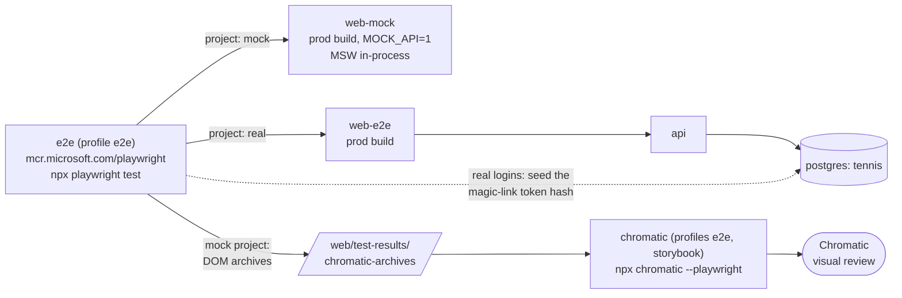

- **Two projects, one suite.** Every spec runs against `web-mock` (no API) and `web-e2e` (real API and Postgres) unless it opts out. Both are production builds served under their compose hostnames.
- **Phone viewport.** 360×780, touch. The shell specs assert there's no horizontal scroll and that nav targets are at least 44px.
- **Accessibility.** `@axe-core/playwright` fails a test on any *serious* or *critical* WCAG 2.1 A/AA violation. The `/dev/ui` showcase is checked in both colour schemes, and that's what keeps the token pairings at AA contrast.
- **Real-API login without an inbox.** The E2E stack runs the `Log` email provider, so no email is sent. The test submits the real login form, then replaces the newest unused `MagicLinkTokens.TokenHash` for that email with SHA-256 of a token it knows (a persona with roles gets its User inserted first, since asking for a link creates none), opens `/auth/verify` with it and presses "Sign in". One test first fetches the link with a bare GET, as a mail scanner would, and checks it still signs in. Everything but delivery runs for real, and the app has no test-only endpoint. The cost is that this one helper (`e2e/support/auth.ts`) knows two table names.
- **Readiness.** Compose holds the runner until `web-e2e`, `web-mock` and (through `web-e2e`) `api` are healthy. `e2e/support/global-setup.ts` repeats the wait against `/login` and the API's `/health/ready`, for runs that bypass compose's ordering (`--no-deps`, or `E2E_*_URL` overrides).
- **Visual review (ADR-0015).** Specs import `test` from `@chromatic-com/playwright`, which archives each mock-project test's final page (plus explicit `takeSnapshot`s). The `chromatic` compose service uploads them; Chromatic diffs against the accepted baselines and its "UI Tests: social-tennis" check gates the PR (with two projects linked, Chromatic names each check after its project). Dependabot PRs aren't visually reviewed: they get no Chromatic token, so the `ui-tests-dependabot` job reports both projects' checks as passed, described as not run (#158). The real project doesn't snapshot (its data changes every run), and neither does dark mode (Playwright archives replay without `emulateMedia`): the stories below cover it. Mock logins use a fixed `<persona>@example.com` so snapshots are stable.

### Component stories: Storybook (#46)

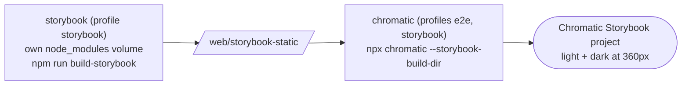

- **What has stories.** Every primitive in `components/ui`, the result-status badges and the bottom nav: `*.stories.tsx` beside each component. Components bound to a server action (`PlayerSwitcher`, the Club, Player and League forms) have stories too (#189): `preview.tsx` registers `sb.mock("../src/lib/actions.ts")`, so stories import `src/lib/__mocks__/actions.ts` instead and the real module, which needs the request and the API, never loads. Its actions never settle, so a pressed button stays pending; `createLeague` returns a refusal, so the setup form shows its errors. Manager pages get page snapshots in #187.
- **Setup.** `@storybook/nextjs-vite` with `nextjs.appDirectory` (mocks for `next/link`, `next/form`, `usePathname`). `preview.tsx` imports `globals.css` and sets the Geist variables the root layout would.
- **Modes.** Each story is snapshotted twice, `light` and `dark`: Chromatic's `colorScheme` sets `prefers-color-scheme`, which swaps the tokens.
- **A second Chromatic project.** Chromatic keeps Storybook and Playwright builds in separate projects linked to the same repo, so the upload uses `CHROMATIC_STORYBOOK_PROJECT_TOKEN`, and each project posts its own checks. Until that secret is set, CI builds the stories and skips the upload.
- **Not in the app.** `.dockerignore` keeps `.storybook/`, the stories and `src/lib/__mocks__/` out of the production image, so `next build` doesn't type-check them; the CI job's `tsc` covers them.
- **The `/dev/ui` showcase stays** (owner, 2026-11-18): its spec runs axe on every primitive in both colour schemes.

The test host runs the real `Program.cs` — including startup migration — against a separate `tennis_test` database on the same Postgres service, so tests are isolated from dev data but identical in behaviour.

`OpenApiContractTests` uses the same host but asserts on the **generated OpenAPI document** rather than on any one endpoint: that no 2xx JSON response is a bare array (ADR-0012), and that every operation outside a short anonymous allow-list both declares a 401 and answers an anonymous call with one (ADR-0017). This is where repo-wide contract rules get enforced when no type-level mechanism can express them; it tests the published wire surface, so it holds regardless of how the C# is written.

## CI

Two GitHub Actions workflows, one per half of the repo (ADR-0002), every step a `docker compose` invocation with the same images and commands as local dev — nothing runs bare on the runner. Both run on every PR and every push to `main`; a first `changed paths` job in each decides whether the others have anything to do:

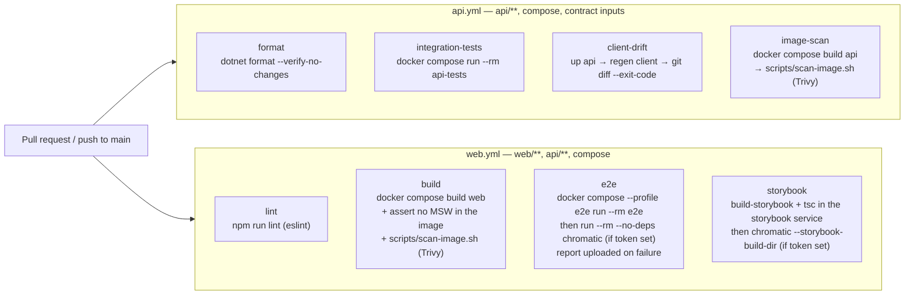

**Every check reports on every PR.** The workflows have no `paths` filter: GitHub leaves the checks of a path-skipped workflow *pending*, which would block a docs-only PR as soon as those checks were required. Instead each job is skipped with `if`, which reports as skipped and satisfies a required check. So the job names above are safe to require in a ruleset on `main`. Two details keep that honest. The jobs run unless `changed paths` explicitly says there is nothing to do, so a failed or cancelled detector runs everything and can't let a required check pass by being skipped. And when e2e is skipped, a `chromatic-skip` job runs `chromatic --skip` for each Chromatic project that has a token, because Chromatic's own "UI Tests: <project>" checks are only posted when a build is published or skipped, and would otherwise stay unreported.

**Image scan** (#114). Both production images are scanned as CI builds them: `web` in the build job, `api` in its own `image-scan` job. `scripts/scan-image.sh` runs Trivy from its official image, pinned by digest (Trivy's own release channels were compromised once, GHSA-69fq-xp46-6x23, so a tag alone isn't trusted). It fails on a **critical** vulnerability **that has a fix**; anything without a fix, or below critical, is reported only by Dependabot alerts and the monthly base-image PRs. An accepted finding goes in `.trivyignore.yaml` with a statement and an `expired_at` review date, after which Trivy stops honouring it and the scan fails again. The scan runs when its app's files change, so a vulnerability published later shows up on the next PR that touches that app, or the next base-image PR. Locally: `docker compose build api && scripts/scan-image.sh social-tennis-api`.

**Infrastructure.** `infra.yml` runs `terraform fmt -check` and `terraform validate` in the toolbox image when `infra/` changes, with the same always-reports structure as the other two.

**Wireframes on GitHub Pages.** A third workflow, `pages.yml`, publishes `docs/ui/*.html` to <https://l1em1on1.github.io/social-tennis/> on every push to `main` that changes that folder. It copies static files and builds nothing. It reports no check on pull requests.

**Code review.** `review.yml` has Claude (Opus at high effort, through `anthropics/claude-code-action`, pinned by commit SHA) review a pull request when the owner adds the `claude-review` label, and comment on it directly. A finding on a line the PR changed is a comment on that line, since GitHub takes line comments only within the diff. Every other finding is listed with its `path:line` in the single summary comment. The job removes the label as it starts, so adding it again asks for a re-review. A step before the review writes the PR's earlier line comments (the bot's and collaborators') to `pr-context/`, because `gh pr view --comments` doesn't show them, so a re-review doesn't repeat open findings. It is advice, not a gate: its check should not be required, a run that fails (a usage limit, or a rejected token) ends green with a comment giving Claude's error and what to do about it, and it builds and runs nothing from the repository.

It bills the owner's Claude subscription through an OAuth token (`claude setup-token`), never API credits, which is why it runs only on request. Each run reports what it used (#176). The job summary gets a table of tokens per model, from the result message's `modelUsage`, which unlike `usage` counts subagents and compaction. It also shows the turns and the duration. Claude's summary comment from that run gets a one-line footer with the totals. The dollar figure in both is what those tokens would cost at API prices, not a charge. Only these numbers are read from the run's output: the action's `display_report` would publish the whole session on this public repo. The token is a secret of the `review` environment, deployable from `main` only. The workflow runs on `pull_request_target`, so its definition and Claude's configuration (`.claude/`, `CLAUDE.md`) always come from `main`, and no other branch's workflow can read the token. The PR's files are checked out, without credentials, into `pr-head/` for Claude to read. It runs only for branches of this repository (not forks, not Dependabot's PRs, not drafts), with tools limited to reading files, reading the PR and commenting, and it posts with the workflow's own token. Until the token is set, it says so and passes. The one-time setup is in the workflow's header.

**Build hygiene.** `api/Directory.Build.props` turns warnings into errors with the recommended analyzers, and `api/.editorconfig` holds the C# style rules `dotnet format` checks. It lives under `api/` because the compose services mount `./api` alone. EF Core's generated migrations are marked `generated_code`. ESLint runs in its own job because `next build` no longer lints.

**Dependency updates.** Dependabot (`.github/dependabot.yml`) opens monthly grouped PRs, minor and patch versions only, for npm, NuGet, GitHub Actions, the Docker base images, the Terraform providers and the compose images (#113). Major versions are ignored and taken by hand; a vulnerability still raises a Dependabot alert. The Playwright image tag is excluded, because it must equal the `@playwright/test` version: bump it by hand on the npm PR.

**Actions are pinned by commit SHA**, with the version in a comment (`uses: actions/checkout@<sha> # v5.1.0`), so a moved tag can't change what runs; Dependabot updates both. The post-deploy check uses the runner's own `curl`.

## Versions and notable pins

| Component | Version | Note |
|---|---|---|
| .NET / ASP.NET Core / EF Core | 10.0 (LTS) | Solution uses the `.slnx` format (SDK 10 default) |
| Npgsql.EntityFrameworkCore.PostgreSQL | 10.0.x | EF Relational pinned explicitly to 10.0.10 to unify versions |
| Microsoft.OpenApi | 2.11.0 | Template's 2.0.0 has GHSA-v5pm-xwqc-g5wc; 3.x breaks the .NET 10 OpenAPI source generator |
| FluentValidation | 12.1.1 | Core package only — validators are constructed, not DI-resolved (ADR-0011) |
| Next.js / React | 16.3 / 19.2 | `output: "standalone"` for the Docker runtime image |
| Node | 24 (LTS) | Container-only, never on the host |
| API runtime image | `mcr.microsoft.com/dotnet/aspnet:10.0-noble-chiseled-extra@sha256:…` | Ubuntu chiseled (#25): no shell or package manager, runs as `app` (UID 1654). `-extra` adds ICU and tzdata. With no shell, compose's healthcheck is the app probing itself (`dotnet SocialTennis.Api.dll healthcheck`, `HealthProbe.cs`); the dev overlay, on the SDK image, keeps a bash probe. Azure probes over HTTP |
| Web runtime image | `node:24-alpine@sha256:…` | Runs as the image's `node` user (UID 1000); the app's files are root-owned, only `.next/cache` is writable |
| Build images | `dotnet/sdk:10.0@sha256:…`, `node:24-alpine@sha256:…` | Pinned the same way, so a build is reproducible |
| Postgres | 18-alpine | Volume mounted at `/var/lib/postgresql` (18+ image layout) |
| openapi-typescript / openapi-fetch | 7.x / 0.17.x | `js-yaml` override in `web/package.json` clears a dev-chain CVE |
| eslint / eslint-config-next | 9.x / 16.3.0 | `typescript-estree`'s `minimatch` is overridden to ^11.0.1 (no fixed 10.x, #133). Drop each override in `web/package.json` once its parent ships a fixed version |
| msw / openapi-msw | 3.0.5 / 2.1.1 | Exact pins. msw 3 renamed `onUnhandledRequest` to `onUnhandledFrame` |
| @playwright/test | 1.65.1 | Exact pin; **must equal** the `mcr.microsoft.com/playwright:v1.65.1-noble` image tag in `docker-compose.yml` (browsers ship in the image). Dependabot ignores the image (named `playwright` there), so both move together by hand on the npm PR |
| @axe-core/playwright | 4.14.0 | Exact pin |
| pg | 8.x | E2E only: seeds the magic-link token for real-API logins |
| chromatic / @chromatic-com/playwright | 18.13.6 / 1.0.0 | Exact pins. The CLI needs git and the full history, hence the whole-repo mount in the `chromatic` service. The plugin pins `storybook` 10.2.13 exactly; `overrides` in `web/package.json` lift it to 10.6.7 and its `esbuild` to ^0.28.1 for security fixes (#133) |
| storybook / @storybook/nextjs-vite / vite | 10.6.7 / 10.6.7 / 8.3.8 | Exact pins (#46). `storybook` is a direct dependency and also in `overrides`; the two must stay equal, or npm refuses the install |
| TypeScript (language server only) | 5.x | sbx `toolchain` kit; 7.x ships no `lib/tsserver.js` |
| RTK | 1.2.0 | sbx `rtk` kit; installer fetched at the v1.2.0 commit SHA, `RTK_VERSION` pinned so it never resolves "latest"; it checks the release checksum |
| Terraform / azurerm / neon / cloudflare provider | 1.17.2 / ~> 5.14 / 0.18.0 / ~> 5.19 | `infra/` only. The Neon provider is community-maintained and pinned exactly. Cloudflare 5 renamed the DNS resource to `cloudflare_dns_record` and wants full record names |
| Azure CLI | 2.92.0 | In the infra toolbox image, with the `communication` extension 1.14.0 for `scripts/setup-domain.sh`. Dependabot can't see a CLI extension: bump it by hand from `src/communication/setup.py` in Azure/azure-cli-extensions |
| Trivy | `aquasec/trivy:0.76.2@sha256:…` | The CI image scan (`scripts/scan-image.sh`). Pinned by digest in the script, by hand: Dependabot can't see images named in scripts. Bump to a release published after any advisory on Trivy itself |
| Backup job images | `postgres:18-alpine@sha256:…`, `mcr.microsoft.com/azure-cli:2.92.0@sha256:…` | `infra/modules/backup` only. Pinned by digest in Terraform, by hand: Dependabot can't see images named there. `pg_dump`'s major version must be at least Neon's server version |
| curl image | `curlimages/curl:8.11.1@sha256:…` | `scripts/setup-domain.sh` only (the host may have no curl). Pinned by digest in the script, by hand: Dependabot can't see images named in scripts |
| csharp-ls / typescript-language-server / typescript | 0.28.0 / 6.1.0 / 5.9.3 | sbx `toolchain` kit (`.sbx/kits/toolchain/toolchain.dockerfile`); exact pins. Its stages are pinned by digest: `dotnet/sdk:10.0` (the same digest as `api/Dockerfile`; SDK 10.0.404), `node:24-trixie-slim` (Node 24.22.3), `debian:trixie-slim`. Dependabot doesn't watch `.sbx/`: bump these by hand. Claude Code comes with the claude kit's image, and `sandbox.sh` runs `claude update` on every start |
| Azure.Communication.Email | 1.1.0 | The API's only mail provider SDK (ADR-0020) |
| sbx (Docker Sandboxes) | ≥ 0.51.0 | Kits are `schemaVersion: "3"` (#175): 0.51 made the built-in `claude` agent a v3 kit, which can't be combined with v1/v2 kits. `sandbox.sh` checks the version |

**Bumping a digest-pinned base image** (#25). Each `FROM` in `api/Dockerfile` and `web/Dockerfile` is `tag@sha256:digest`: the tag says what it is, the digest fixes the exact image. Dependabot's `docker` updates (monthly, #113) open a PR that moves both; CI builds and tests it like any change. By hand: `docker buildx imagetools inspect <image>:<tag>` prints the current digest (the `Digest:` line); put it after the tag, then run the API and E2E suites. Keep the tag, never a digest alone, so a reader and Dependabot both know what is pinned.

## Where this goes next

The skeleton, login (#3) and the UI foundation (#40) are built, so every following ticket adds domain, not plumbing. Next is #54 (deny-by-default authorization, health, an injected clock), then #18 (the Admin and Club bootstrap) and the Phase 1 chain #4 → #5 → #6 → #7 → #38 → #42, then #10 → #14. Go-live (#25–#27, #19, #51–#53) follows. The ticket graph is wired as native GitHub issue dependencies, and each ticket's "Blocked by" section must agree with them.

Three decisions those tickets depend on are proposed and not yet accepted: ADR-0016 (dates and the clock), ADR-0017 (error contract, deny-by-default authorization) and ADR-0018 (concurrent Score edits).
