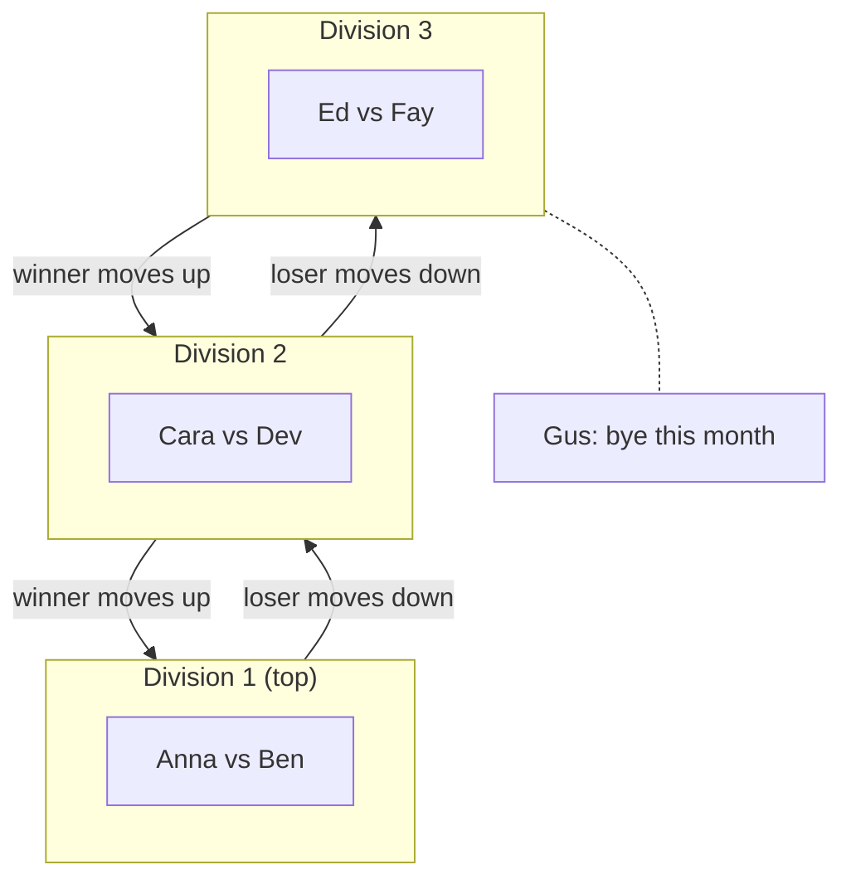
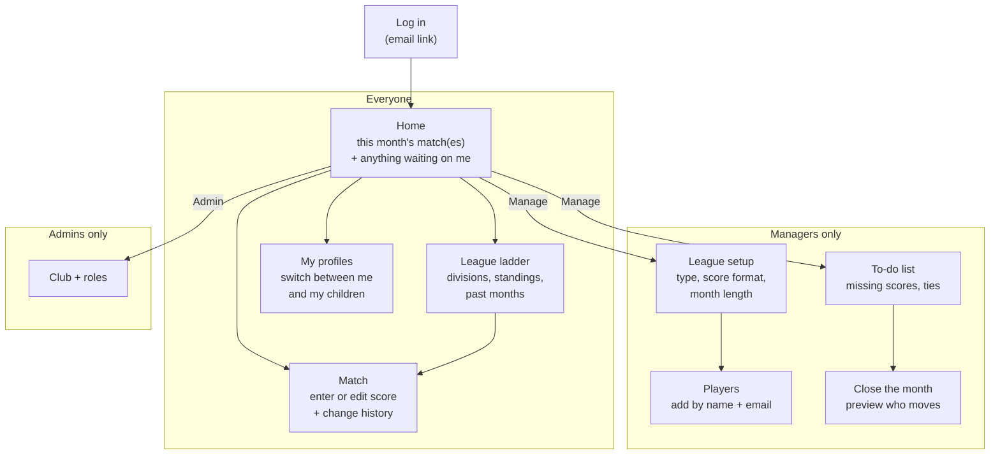
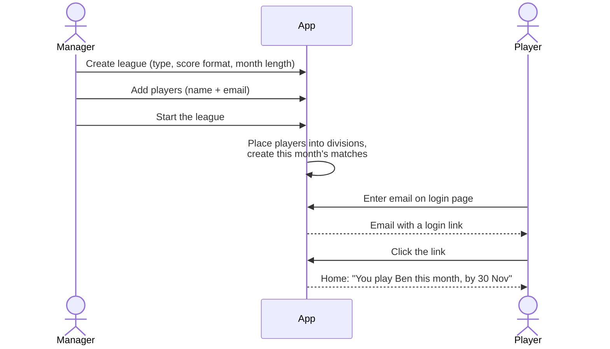
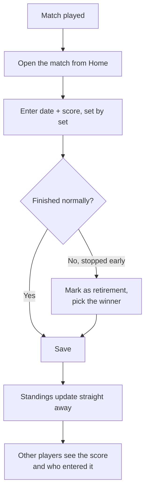
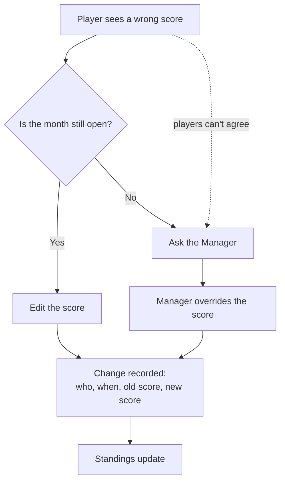
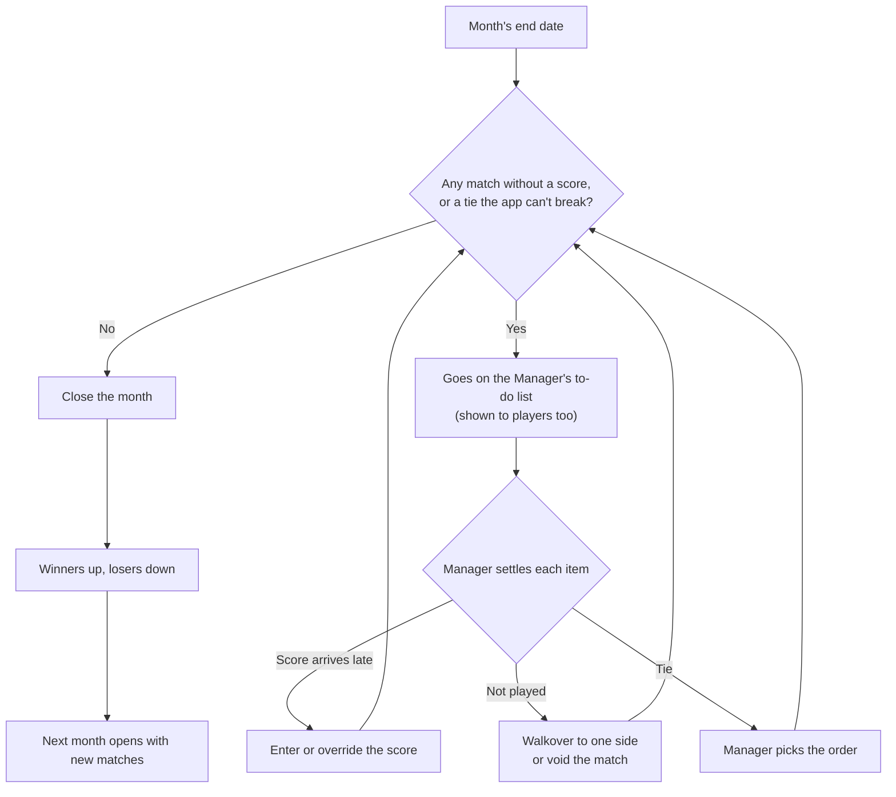

# Social Tennis — Phase 1: Score Collection

_As of 2026-10-26. Plain-language overview for non-technical readers. Domain terms are defined in `CONTEXT.md`; the decisions behind this scope are ADR-0008 (Phasing) and ADR-0013._

## At a glance

Phase 1 replaces the club's WhatsApp-and-spreadsheet league admin with one place to record match scores and see where everyone stands on the ladder. It does one job well: get every league result into the app, keep it honest, and move players up and down the ladder at the end of each month.

- **Players** log in with a link sent to their email, see who they play this month, enter the score after the match, and watch the ladder update.
- **Managers** set up the league, add the players, fix anything that goes wrong, and close each month.
- **The app** works out the standings and who moves up or down, so nobody has to do it by hand.

Arranging match dates, socials and knockout cups come in later phases (see *What comes next*).

## Who uses it

Three roles share one app; one person can hold more than one of them.

| Role | Who they are | What they do in Phase 1 |
| --- | --- | --- |
| Player | A club member playing in a league | Sees this month's opponent, enters and corrects scores, checks the ladder |
| Manager | The club volunteer who runs a league | Creates the league, adds players, overrides scores, settles missing results, closes the month |
| Admin | Whoever looks after the app for the club | Creates the club and decides who is a Manager |

One login can look after several player profiles, so a parent can enter scores for their children.

## How a league works

A league is a **ladder**: a column of small divisions, Division 1 at the top. Each month (a **stage**) everyone plays the others in their division once, and at the end of the month the winner of each division moves up a rung and the loser moves down.

- **Singles and doubles leagues:** each division holds 2 sides, so there is exactly one match per month.
- **Foursomes leagues:** each division holds 4 players who play 3 doubles matches, partnering each of the others once. Each player's games won are added up to rank them.
- **Odd numbers:** if one side is left over, they sit out that month at the bottom of the ladder (a *bye*), neither moving up nor down.
- **The ends stay put:** the winner of Division 1 and the loser of the bottom division don't move.

*Example ladder for a singles league with 7 players. Names are made up.*

**Scores are recorded set by set.** Each league picks its format up front: sets of 6 or 9 games, one set or best of three, and whether a deciding set can be a first-to-10 match tiebreak. If a match stops early (injury, rain, court time up), it is recorded as a **retirement**: the score as it stood plus who won.

## App structure

The app is built for phones first. Players see four main screens; Managers get an extra area behind a "Manage" button.

| Screen | What you see | What you can do |
| --- | --- | --- |
| Home | Your opponent(s) this month, the month's deadline, any score still to enter | Jump to a match or the ladder |
| Match | Both sides, the score set by set, who entered it and every later change | Enter the score; correct it until the month closes |
| League ladder | Every division with this month's results; earlier months | Tap any match to see its score |
| My profiles | The player profiles on your login | Switch which player you're acting as |
| Manager: To-do | Matches with no score, tied divisions | Override a score, award a walkover, void a match, pick a winner |
| Manager: Close the month | Who will move up and down | Confirm, and the next month opens |

## Features in Phase 1

| Area | Feature | Who |
| --- | --- | --- |
| Getting in | Log in with a one-time link sent by email, no password | Everyone |
| Getting in | Manager adds players by name and email before they ever log in; the first time they log in, their profile is already there | Manager, Player |
| Getting in | One login can hold several player profiles (e.g. a parent and their children) | Player |
| League setup | Create a ladder league: singles, doubles, mixed or foursomes | Manager |
| League setup | Choose the score format: 6- or 9-game sets, one set or best of three, match tiebreak allowed or not | Manager |
| League setup | Choose month length and whether months close automatically on their end date or only when the Manager says so | Manager |
| League setup | App places everyone into divisions and creates the month's matches | App |
| Scores | Any player in a match enters the score, set by set, with the date played | Player |
| Scores | Record a retirement: score as it stood plus the winner | Player |
| Scores | Any player in the match can correct the score until the month closes | Player |
| Scores | Every change is kept and shown: who, when, from what to what | Everyone |
| Scores | Manager can override any score | Manager |
| Standings | Live standings per division: matches won, then games difference, then head-to-head | App |
| Month end | To-do list of anything unsettled: matches with no score, ties the app can't break | Manager |
| Month end | Settle a missing match as a walkover (one side awarded it) or void it (counts for nothing) | Manager |
| Month end | Month can't close until the to-do list is empty, so the ladder never moves on a wrong result | App |
| Month end | Winners move up, losers move down, next month's matches appear | App |

## User flows

### 1. Getting started

The Manager does the setup; players just click a link.

### 2. Entering a score after a match

Whoever gets to it first enters the score; the others can see and correct it.

### 3. Correcting a score

There is no approve/reject step in Phase 1. Instead, anyone in the match can fix a wrong score, and every change stays visible, so a mistake is easy to spot and nobody can quietly rewrite a result.

### 4. Closing the month

The ladder only moves once every result is settled.

Each league chooses how this starts: it can close by itself on the end date, or wait until the Manager closes it (scores stay editable until then).

## What comes next

Phase 1 focuses on getting results in. These are planned but held back so the first release can ship sooner:

| Later feature | What it adds | Until then |
| --- | --- | --- |
| Score voting | Players approve or dispute a score; the majority wins and only ties go to the Manager | Anyone can correct; the change history keeps it honest |
| Finding a date | Players mark free dates and the app suggests one that suits both sides | Arrange on WhatsApp as today |
| Substitutes | A stand-in plays one match for an injured partner | Manager handles it |
| Leaving a league | Player asks to withdraw, Manager accepts and rebalances | Manager handles it |
| Knockout cups | Single-elimination draws, seeded by rating | Not available |
| Socials | Sign-up for social sessions and automatic court allocation | Not available |
| Notifications | Emails for new matches, score changes, month close | Players check the app |

## Glossary

| Word | Meaning |
| --- | --- |
| Ladder | The league's column of divisions, Division 1 at the top |
| Division | One rung of the ladder: 2 sides (or 4 players in foursomes) |
| Stage / month | The period to play this rung's matches, usually a month |
| Side | One player in singles, a fixed pair in doubles |
| Bye | Sitting out a month because the numbers don't fit; no move up or down |
| Retirement | A match stopped early; recorded with the score so far and a winner |
| Match tiebreak | A deciding set played as a single first-to-10 tiebreak |
| Walkover | A match not played, awarded to one side by the Manager |
| Void | A match not played and cancelled; counts for nothing |
| Standings | The ranking inside a division that decides who moves |
